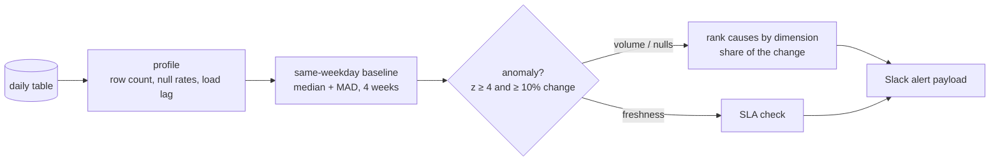

# dq-sentinel

**Data quality anomaly detection with root-cause ranking** for daily-partitioned warehouse tables, on DuckDB.

Most data quality alerts say *that* something broke. The expensive part is the hour someone then spends finding *where*. dq-sentinel profiles each daily partition, compares it with a robust same-weekday baseline, and, when volume or nulls move, ranks the dimension values that explain the change. The alert names the platform before anyone opens a notebook.


## How it works



- **Same-weekday baselines.** Streaming traffic on a Saturday looks nothing like a Tuesday, so each day is compared with the same weekday over the last four weeks.
- **Median and MAD, not mean and standard deviation.** A past incident still sitting in the history window does not drag the baseline down or blow up the variance.
- **Sampling-aware null checks.** A rare-null column measured on a few thousand rows is noisy by nature, so the threshold accounts for binomial noise and does not page anyone over it.
- **Two gates.** An alert needs a z-score of 4 or more *and* a change of at least 10%, which stops tiny but statistically significant moves from paging anyone.
- **Root-cause ranking.** Each dimension value (for example `platform = roku`) is scored against its own baseline, and the alert reports each value's share of the total change.
- **Freshness as an SLA.** A late partition is a contract breach, not a statistical question, so load lag uses a fixed threshold.

## Example alerts

Three simulated incidents, each modeled on a real failure mode:

```
*row_count* on 2026-10-20: 1,673 vs expected 2,066 (-19%, z=-9.5)
Likely source: roku (100%)

*null_rate:user_id* on 2026-10-20: 7.82% vs expected 0.39% (+1905%, z=27.2)
Likely source: android (99%)

*Freshness* on 2026-10-20: landed 11.35h after the partition closed (SLA 6.0h)
```

On clean data it stays quiet: no alerts across 40 simulated seeds.

## Run it

```bash
pip install -r requirements.txt
python simulate.py --db events.duckdb --incident platform_drop   # or null_spike, late_load, or none
python sentinel.py --db events.duckdb --table playback_events \
    --date-col event_date --dim platform --columns user_id --loaded-col loaded_at
pytest -q
```

## Tests

- No alerts on clean data across several seeds.
- A 70% drop on one platform is detected, and that platform is ranked first with over 80% of the change.
- A null spike on one platform is detected and attributed to it.
- A late partition breaks the freshness SLA and raises nothing else.
- An incident four weeks back does not create a false alert today.
- A perfectly flat history does not divide by zero.

## Going to production

| Concern | Here | At scale |
|---|---|---|
| Profiling | full scan in DuckDB | BigQuery `INFORMATION_SCHEMA` and partition-level aggregates, only the new partition |
| Scheduling | CLI | Airflow sensor after each load, or a task appended to the producing DAG |
| Config | CLI flags | YAML per table: columns, dimensions, SLAs, owners |
| Alerting | JSON payload | Slack webhook routed to the table owner, with a link to a pre-filled investigation query |
| State | recomputed | Metrics stored in a history table, so baselines never rescan old partitions |

## Data

All data is synthetic, generated by `simulate.py`.
